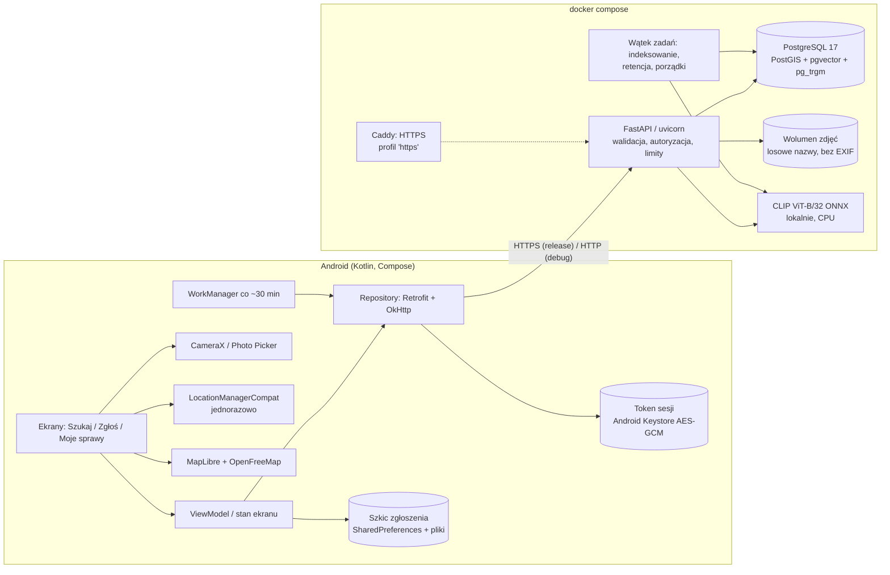
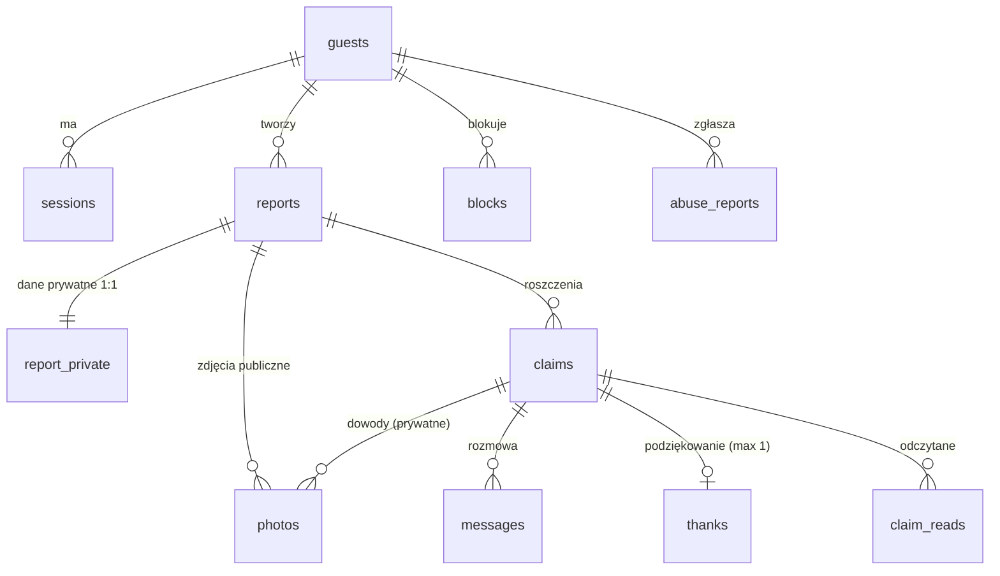
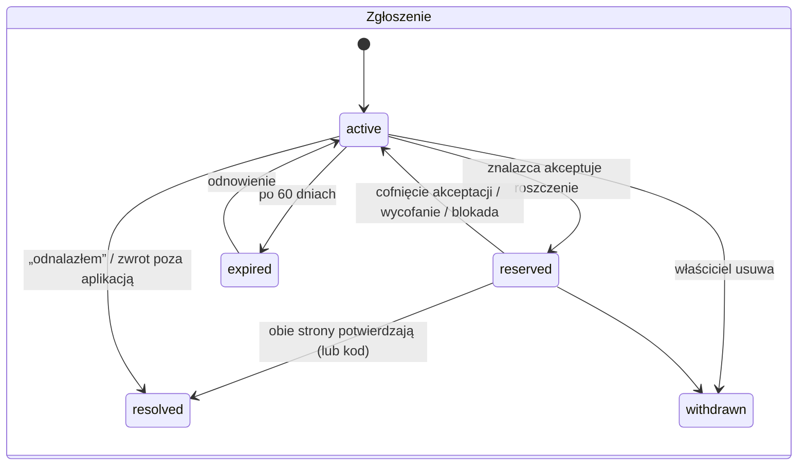
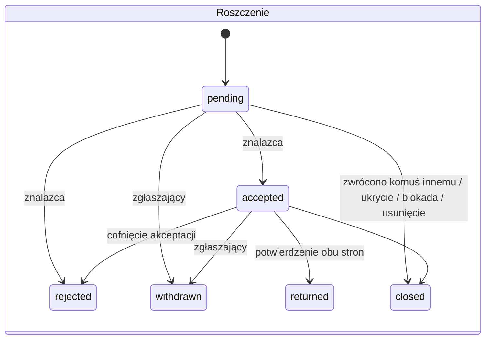

# Architektura Findini

## Widok ogólny



Jeden proces API (można zwiększyć `FINDINI_WORKERS`), jedna baza, jeden wolumen zdjęć. Świadomie **bez mikroserwisów, kolejek i Kubernetesa** — skala pilotażu (≤10 tys. zgłoszeń, ~50 równoległych sesji) mieści się z dużym zapasem w jednym procesie (patrz test obciążenia). Zadania w tle pobierają pracę przez `SELECT … FOR UPDATE SKIP LOCKED`, więc kilka procesów/instancji nie dubluje pracy.

## Przepływ danych: od zguby do zwrotu

```mermaid
sequenceDiagram
  participant F as Znalazca (telefon A)
  participant S as API Findini
  participant O as Właściciel (telefon B)
  F->>S: POST /v1/sessions (cicho, w tle — bez rejestracji)
  F->>S: POST /v1/photos (JPEG bez EXIF) → podpowiedź AI
  F->>S: POST /v1/reports (miejsce dokładne + ukryta cecha → report_private)
  O->>S: GET /v1/reports?lat&lon&radius&q… (bez sesji)
  S-->>O: tylko pola publiczne, obszar ~500 m, „dlaczego pasuje”
  O->>S: GET /claim-form → pytanie; POST /claims (odpowiedź, dowód prywatny)
  F->>S: GET /claims/{id} → odpowiedź obok ukrytej cechy
  F->>S: POST /accept (blokada wiersza zgłoszenia, kod przekazania)
  F->>O: wiadomości w sprawie (tylko uczestnicy)
  O-->>F: pokazuje kod przy spotkaniu
  F->>S: POST /handover {kod} → returned, inne roszczenia zamknięte
  O->>S: POST /thanks (raz)
```

## Najważniejsze decyzje

| Decyzja | Dlaczego | Alternatywy odrzucone |
|---|---|---|
| Natywny Android (Kotlin + Compose) | Prawdziwy dostęp do CameraX, Photo Picker, Keystore, WorkManager; brak warstwy pośredniej | Flutter/RN — dodatkowy stos bez korzyści dla jednej platformy |
| FastAPI + SQLAlchemy + Alembic | Prosty, typowany kontrakt, OpenAPI za darmo, ten sam język co model AI | Ktor (ten sam język co app, ale słabsze środowisko ML), Node |
| PostgreSQL + PostGIS + pgvector w jednej bazie | Geowyszukiwanie (`geography`, `ST_DWithin`, GiST), podobieństwo wektorów i tekst (pg_trgm) w jednym zapytaniu i jednej transakcji | Osobny silnik wektorowy/Elasticsearch — nadmiarowe przy 10 tys. rekordów |
| Publiczna lokalizacja = środek komórki siatki ~500 m | Wszystkie punkty z komórki dają identyczną odpowiedź ⇒ seria zapytań „w promieniu” nie odtworzy ukrytego punktu (test `test_repeated_radius_queries_do_not_reveal_exact_point`) | Losowy szum przy każdym zapytaniu — uśrednianie odpowiedzi ujawnia punkt |
| Lokalny CLIP w ONNX Runtime | Bez kluczy, kosztów i wysyłania zdjęć do zewnętrznych firm; działa na CPU (~20–30 ms); jeden model daje embeddingi i zero‑shot | API chmurowe (koszt, prywatność, zależność), DINOv2 (lepsze egzemplarze, ale bez opisów tekstowych) |
| Asystent wyszukiwania na regułach | Deterministyczny, bez kluczy, bez ryzyka prompt injection; wystarcza dla słownika kategorii/kolorów/czasu/miejsc | LLM — opcjonalne rozszerzenie (patrz „Rozszerzenia”) |
| Sesja gościa z losowym tokenem + kod odzyskiwania | Szukanie bez konta, publikacja bez danych osobowych, a jednocześnie prawdziwa autoryzacja zasobów | Konto e‑mail (bariera), identyfikator urządzenia (nie jest uwierzytelnieniem) |
| Roszczenia tylko do zgłoszeń „znaleziono” | Jedna, spójna maszyna stanów; decyzję o wydaniu zawsze podejmuje osoba fizycznie mająca przedmiot. Przy zgubie znalazca dodaje zgłoszenie „znaleziono” („Znalazłem coś podobnego”), a właściciel dostaje je w dopasowaniach | Dwa symetryczne przepływy — więcej stanów, niejasne, kto decyduje |
| Odpytywanie zamiast WebSocketów/FCM | Prostota, brak konta Firebase; czat odświeża się co 4 s tylko przy otwartym ekranie, a WorkManager co ~30 min | FCM wymaga projektu Google i klucza |
| Sync endpointy + pula wątków | Prostszy kod i transakcje; wydajność wystarczająca (p95 33–44 ms przy 50 sesjach) | asyncio + asyncpg — złożoność bez potrzeby |

## Model danych



| Tabela | Najważniejsze kolumny | Uwagi |
|---|---|---|
| `guests` | `alias`, `recovery_hash` (HMAC‑SHA256), `banned_at` | brak imienia, e‑maila, telefonu |
| `sessions` | `token_hash` (SHA‑256), `revoked_at`, `last_used_at` | sam token nigdy nie jest zapisywany |
| `reports` | `kind`, `status`, `category`, `attributes` (JSONB, walidowane schematem kategorii), `colors[]`, `occurred_from/to` (UTC), `cell_id`, `public_lat/lon`, `public_geog` (kolumna generowana, GiST), `area_radius_m`, `search_text` (indeks trigramowy z `unaccent`), `hidden_at`, `expires_at` | tylko dane publiczne |
| `report_private` | `exact_lat/lon`, `accuracy_m`, `uncertainty_m`, `location_source` (gps/map), `secret_details`, `claim_question` | nigdy w publicznym API ani indeksie tekstowym/wektorowym |
| `photos` | `purpose` (report/evidence), losowy `storage_key`, `embedding vector(512)`, `embedding_model`, `embedding_status` | `CHECK`: dowód nie może mieć wektora |
| `claims` | `status`, `answer`, `proof_details`, `handover_code`, `handover_attempts`, `finder/owner_confirmed_at`, `lost_report_id` | `UNIQUE(report_id, claimant_id)`; **`UNIQUE(report_id) WHERE status IN ('accepted','returned')`** |
| `messages`, `claim_reads` | `kind` (text/system), `body` | czytane tylko przez uczestników |
| `thanks` | `UNIQUE(claim_id)` | jedno serduszko na zwrot |
| `blocks`, `abuse_reports` | `UNIQUE(reporter_id, target)` | moderacja |
| `audit_events` | zmiany stanów bez treści | diagnostyka sporów |
| `rate_buckets` | okna stałe na sesję i skrót IP | czyszczone po 2 dobach |

Indeksy: GiST na `public_geog`, B‑tree `(kind, status, published_at DESC, id DESC)` pod paginację, GIN trigram na `f_unaccent(lower(search_text))`, GIN na `colors`, częściowy na zdjęcia oczekujące na indeksowanie. Przy 10 tys. zgłoszeń wyszukiwanie wektorowe jest dokładne (skan ~3 tys. wektorów, p95 wyszukiwania zdjęciem ~81–107 ms łącznie z inferencją); powyżej ~100 tys. warto dodać indeks HNSW (`hnsw.iterative_scan`).

## Maszyny stanów





Reguły są zakodowane w `backend/app/domain/states.py` (testy jednostkowe) i egzekwowane w `services/claims.py`. Każda zmiana stanu sprawy: blokada wiersza zgłoszenia (`SELECT … FOR UPDATE`, z `populate_existing`), potem roszczenia — zawsze w tej kolejności. Druga linia obrony: unikalny indeks częściowy uniemożliwia dwa zaakceptowane/zwrócone roszczenia jednej rzeczy. Operacje są idempotentne (powtórzone `accept`/`handover`/`thanks` zwracają bieżący stan). Test: 6 równoległych akceptacji → dokładnie jedna udana; równoległe kod+potwierdzenie → jeden zwrot, jedna wiadomość systemowa, jedno serduszko.

## Wyszukiwanie i dopasowania
1. **Filtry twarde** (SQL): rodzaj, stan, ukrycie, kategoria/rodzaj, kolory (z rozszerzeniem o pokrewne: granatowy≈czarny≈niebieski…), marka, przedział czasu zdarzenia, okrąg wokół wybranego punktu (`ST_DWithin` po publicznym środku komórki), prostokąt mapy.
2. **Tekst**: `word_similarity` (pg_trgm) na tekście bez ogonków — działa dla odmiany („parasola”, „zolty”).
3. **Wyjaśnienie** (`domain/matching.py`): każdy sygnał daje punkty i zdanie („Kolor: czarny”, „Blisko (ok. 300 m)”, „Zgodny czas”), niezgodności dają ostrzeżenia („Inny kolor”, „Znalezione wcześniej, niż zgłoszono zgubienie”). Poziom „mocne” wymaga ≥6 pkt, braku poważnej niezgodności **i** cechy wyróżniającej egzemplarz (dokładny kolor, marka/brelok albo wyróżniające się zdjęcie). Użytkownik nie widzi procentów.
4. **Zdjęcie**: bezwzględne podobieństwo słabo odróżnia egzemplarze (eksperyment), więc mocniej liczy się tylko zdjęcie, które **wyraźnie wyróżnia się** na tle pozostałych kandydatów (przewaga top‑1 nad top‑2 ≥ 0,05; precyzja ≈ 0,72 na zbiorze testowym).

## Aplikacja Android — struktura
- `data/` — modele API (kotlinx.serialization), `FindiniApi` (Retrofit), `Repository` (sesja w tle, mapowanie błędów na komunikaty PL, ponowienie po utracie sesji), `SecureStore` (Keystore), `DraftStore`.
- `ui/screens/` — Home (lista/mapa/filtry/asystent), Detail, Create (kreator + CameraX), MyReport (widok właściciela, dopasowania, roszczenia), Claim, Case (stan, decyzje, kod, czat), PhotoSearch, Settings/Recovery.
- `ui/components/` — karty, odznaki rodzaju (kolor **i** ikona **i** tekst), mapy MapLibre (obszary, wybór miejsca z pinezką i kołem niepewności), stany puste/błędu/offline.
- `work/UpdatesWorker` — okresowe sprawdzanie dopasowań i wiadomości (bez lokalizacji).

## Rozszerzenia (niezaimplementowane, świadomie)
- Opcjonalny LLM do asystenta (np. Claude) — tylko jako parser do edytowalnych filtrów, z walidacją schematu i limitem kosztu; treść ogłoszeń nigdy jako instrukcje.
- Push przez FCM/UnifiedPush zamiast odpytywania.
- Maskowanie fragmentów zdjęcia na telefonie (rozmycie wskazanego obszaru) z podglądem wyniku.
- DINOv2 jako drugi model do podobieństwa egzemplarzy (lepsze rozróżnianie, kosztem drugiego modelu).
